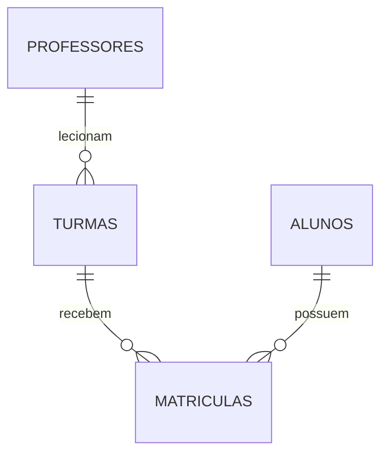

# Relacionamento N–N no Laravel: matrículas de alunos em turmas

Uma turma pode ter vários alunos, e o mesmo aluno pode participar de várias turmas. Nesta aula, vamos representar esse relacionamento no banco e experimentar três formulários para registrar a mesma matrícula.

O exemplo aplica o que vimos em [Models](../05-models/), [Eloquent](../06-orm-eloquent/), [Views](../09-views/) e [Autenticação](../11-autenticacao-autorizacao/). É um projeto de matrículas separado da biblioteca, com cadastro, consulta, edição e exclusão de professores, turmas e alunos. Todas as telas do sistema exigem login, com exceção da tela de entrada.

## Índice

1. [Entender as relações](#1-entender-as-relações)
2. [Criar a tabela de matrículas](#2-criar-a-tabela-de-matrículas)
3. [Definir os relacionamentos nos Models](#3-definir-os-relacionamentos-nos-models)
4. [Registrar uma matrícula](#4-registrar-uma-matrícula)
5. [Montar as três telas](#5-montar-as-três-telas)
6. [Listar e desmatricular](#6-listar-e-desmatricular)
7. [Executar e testar](#7-executar-e-testar)

## 1. Entender as relações

- **Professor e turma (1–N):** um professor pode lecionar em várias turmas, mas cada turma tem um professor. A chave estrangeira `professor_id` fica em `turmas`.
- **Aluno e turma (N–N):** um aluno pode participar de várias turmas, e cada turma pode ter vários alunos. A tabela `matriculas` guarda os pares `turma_id` e `aluno_id`.



Suponha que Web 1 tenha ID 1, Web 2 tenha ID 2, Ana tenha ID 5 e Bruno tenha ID 6. Três registros em `matriculas` representam a seguinte situação:

| `turma_id` | `aluno_id` | Significado |
|---|---|---|
| 1 | 5 | Ana está em Web 1 |
| 1 | 6 | Bruno está em Web 1 |
| 2 | 5 | Ana também está em Web 2 |

O nome de Ana continua gravado uma única vez em `alunos`. A tabela intermediária registra **em quais turmas ela está**.

## 2. Criar a tabela de matrículas

A [migration de matrículas](exemplos/database/migrations/2026_11_17_000004_create_matriculas_table.php) é executada depois das migrations de alunos e turmas:

```php
Schema::create('matriculas', function (Blueprint $table) {
    $table->foreignId('turma_id')->constrained('turmas')->cascadeOnDelete();
    $table->foreignId('aluno_id')->constrained('alunos')->cascadeOnDelete();

    $table->primary(['turma_id', 'aluno_id']);
});
```

As duas chaves estrangeiras exigem que turma e aluno existam. A chave primária é **composta**: o par completo deve ser único. Ana pode estar em Web 1 e Web 2, mas só uma vez em cada uma.

Se um aluno ou uma turma for excluído do cadastro, o banco remove seus vínculos em `matriculas`. A exclusão de um professor com turmas é bloqueada: primeiro transfira as turmas para outro professor.

## 3. Definir os relacionamentos nos Models

Em [`Turma`](exemplos/app/Models/Turma.php):

```php
public function alunos(): BelongsToMany
{
    return $this->belongsToMany(Aluno::class, 'matriculas', 'turma_id', 'aluno_id');
}
```

Em [`Aluno`](exemplos/app/Models/Aluno.php):

```php
public function turmas(): BelongsToMany
{
    return $this->belongsToMany(Turma::class, 'matriculas', 'aluno_id', 'turma_id');
}
```

Após a classe relacionada e o nome da tabela intermediária, vem a chave do Model **em que o método está escrito**. Por isso, `turma_id` vem primeiro em `Turma` e `aluno_id` vem primeiro em `Aluno`. Não precisamos de um Model separado para esta tabela intermediária: ela só guarda os vínculos.

Na relação 1–N, [`Professor::turmas()`](exemplos/app/Models/Professor.php) usa `hasMany`, e `Turma::professor()` usa `belongsTo`. No formulário de turma, o select de professores envia `professor_id`, que é gravado na tabela `turmas`.

## 4. Registrar uma matrícula

Cada formulário envia os mesmos dois campos para `POST /matriculas`. O [`MatriculaController`](exemplos/app/Http/Controllers/MatriculaController.php) valida os IDs e registra o vínculo:

```php
$dados = $request->validate([
    'turma_id' => ['required', 'integer', 'exists:turmas,id'],
    'aluno_id' => ['required', 'integer', 'exists:alunos,id'],
]);

$turma = Turma::findOrFail($dados['turma_id']);
$turma->alunos()->syncWithoutDetaching([$dados['aluno_id']]);
```

`syncWithoutDetaching()` acrescenta o aluno à turma se o par ainda não existir e mantém os outros alunos matriculados. Não usamos `sync()` aqui: ele ajusta a lista inteira e removeria os alunos que não estivessem no array enviado. Após salvar, o Controller abre os detalhes da turma.

## 5. Montar as três telas

| Tela | Como a turma é informada | Como o aluno é informado |
|---|---|---|
| [Matricular por IDs](exemplos/resources/views/matriculas/ids.blade.php) | Digitar o ID | Digitar o ID |
| [Matricular por listas](exemplos/resources/views/matriculas/selects.blade.php) | Escolher em um select | Escolher em um select |
| [Detalhes da turma](exemplos/resources/views/turmas/show.blade.php) | Campo oculto com o ID da turma aberta | Escolher em um select |

**Por IDs.** O aluno da disciplina pode localizar os IDs nas listagens e digitá-los nos campos numéricos:

```blade
<input type="number" name="turma_id" required>
<input type="number" name="aluno_id" required>
```

**Por listas.** Um select mostra o nome do registro, mas envia o ID definido em `value`. O select de turmas segue a mesma lógica:

```blade
<select name="aluno_id" required>
    <option value="">Selecione</option>
    @foreach ($alunos as $aluno)
        <option value="{{ $aluno->id }}">{{ $aluno->nome }}</option>
    @endforeach
</select>
```

**Nos detalhes da turma.** A turma já está definida pela página aberta. O formulário guarda seu ID em um campo oculto, e o select oferece apenas alunos ainda não matriculados naquela turma:

```blade
<input type="hidden" name="turma_id" value="{{ $turma->id }}">
```

Os três formulários têm `method="POST"`, enviam para `route('matriculas.store')` e incluem `@csrf`. Muda a forma de escolher os IDs; a operação no servidor é a mesma.

## 6. Listar e desmatricular

Na tela de detalhes, o Controller carrega os alunos da turma. A View percorre `$turma->alunos`, que contém os registros relacionados. Ao lado de cada aluno existe um formulário:

```blade
@foreach ($turma->alunos as $aluno)
    <form method="POST" action="{{ route('matriculas.destroy', [$turma, $aluno]) }}">
        @csrf
        @method('DELETE')
        {{ $aluno->nome }}
        <button type="submit">Desmatricular</button>
    </form>
@endforeach
```

O endereço contém a turma e o aluno. O Controller usa os dois para remover apenas a matrícula:

```php
$turma->alunos()->detach($aluno->id);
```

Observe a diferença: `$turma->alunos` é a lista que usamos para exibir dados; `$turma->alunos()` dá acesso à relação, na qual chamamos `syncWithoutDetaching()` e `detach()`. Desmatricular Ana de Web 1 preserva o cadastro dela e sua matrícula em Web 2.

## 7. Executar e testar

Siga o [guia do exemplo](exemplos/README.md) para copiar os arquivos da aula em um Laravel 13 novo e preparar o banco. As [rotas de professores, turmas, alunos e matrículas](exemplos/routes/web.php) ficam no grupo com o middleware `auth`, reaproveitando o login por sessão da aula 11.

1. Entre com a conta de aula e consulte as turmas e os alunos criados pelo Seeder.
2. Matricule um aluno usando seus IDs e depois repita com os dois selects. Tente enviar o mesmo par novamente e observe que o vínculo aparece uma única vez.
3. Matricule o mesmo aluno em outra turma pela tela de detalhes. Consulte a página do aluno para ver as duas turmas.
4. Desmatricule o aluno de uma delas. Verifique que ele permanece na outra turma e na listagem de alunos.

Referência: [Laravel 13 — Relacionamentos do Eloquent](https://laravel.com/docs/13.x/eloquent-relationships#many-to-many).
