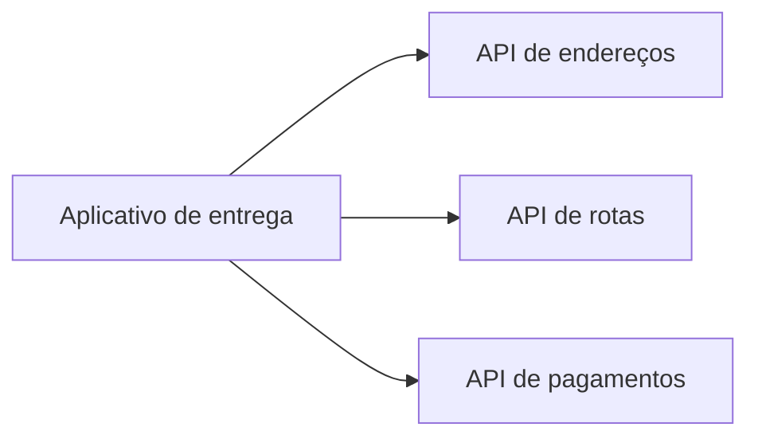
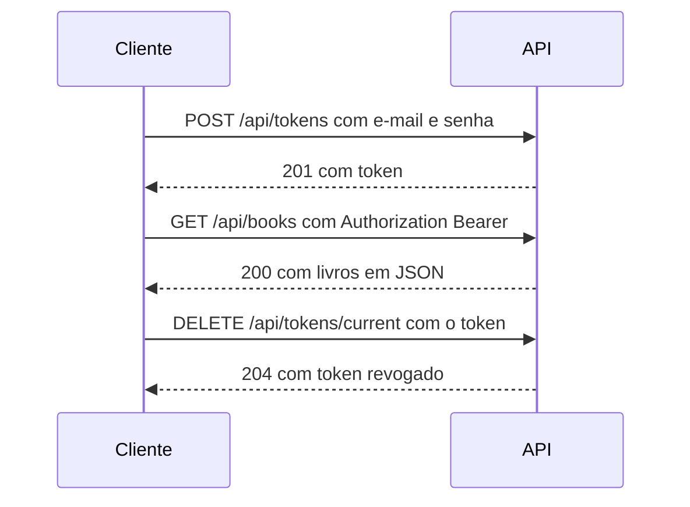
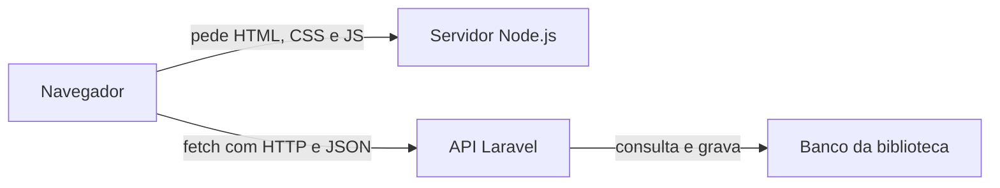

# APIs na Web: do contrato REST à biblioteca em Laravel

Um aplicativo de entrega precisa localizar um endereço, calcular o trajeto e confirmar um pagamento. Ele pode pedir esses serviços a sistemas especializados. A **API** é a interface que diz como fazer esses pedidos e o que esperar como resposta.

Nesta aula, primeiro estudaremos APIs Web sem depender de uma linguagem. Depois, a biblioteca da [aula 12](../12-storage/) fornecerá uma API de livros. Um aplicativo separado, servido por Node.js, vai consumi-la.

## 1. Quem fornece e quem consome uma API?

API significa **interface de programação de aplicações**. APIs também existem dentro de bibliotecas e sistemas operacionais. Nosso foco aqui é a API Web, em que programas trocam mensagens pela rede, geralmente com HTTP.

- **Fornecer** uma API é implementar operações, publicar o contrato e responder às requisições. O fornecedor decide quais dados e ações ficam disponíveis.
- **Consumir** uma API é montar requisições de acordo com o contrato e usar o resultado. O consumidor pode ser um navegador, um aplicativo de celular, outro servidor ou um script.

O mesmo sistema pode exercer os dois papéis. Uma loja pode fornecer uma API para seu aplicativo e consumir um serviço de pagamento.



| Serviço com API | Exemplo de uso |
|---|---|
| [ViaCEP](https://viacep.com.br/) | Preencher parte do endereço a partir do CEP |
| [OpenWeather](https://openweathermap.org/api) | Exibir o clima atual ou a previsão em um aplicativo |
| [Mercado Pago](https://www.mercadopago.com.br/developers/pt/docs) | Gerar cobranças e integrar pagamentos |
| [GitHub REST API](https://docs.github.com/en/rest) | Consultar repositórios, issues e outros dados do GitHub |

Cada serviço tem suas regras: alguns pedem chave de acesso, limitam o número de chamadas ou cobram conforme o plano e o uso. Consulte a documentação antes de integrar.

## 2. REST, recursos e endpoints

**REST** é um estilo de arquitetura. Uma API HTTP inspirada em REST organiza as operações em torno de **recursos**, como livros, autores ou pedidos. O endereço identifica o recurso; o método HTTP comunica a intenção. Uma aplicação pode usar HTTP e JSON sem adotar todas as restrições de REST.

| Conceito | Exemplo |
|---|---|
| Recurso | Livro |
| Coleção | `/api/books` |
| Recurso individual | `/api/books/42` |
| Endpoint de consulta | `GET /api/books/42` |
| Endpoint de alteração | `PUT /api/books/42` |
| Representação | JSON com título, ISBN, autor e URL da capa |

Neste material, identificamos um endpoint pelo **método e caminho**. Assim, `GET /api/books` e `POST /api/books` têm o mesmo caminho e realizam operações diferentes.

| Método | Uso comum | Exemplo |
|---|---|---|
| GET | Consultar uma coleção ou um recurso | `GET /api/books/42` |
| POST | Criar um recurso em uma coleção | `POST /api/books` |
| PUT | Enviar a representação de atualização completa | `PUT /api/books/42` |
| PATCH | Atualizar apenas parte dos campos | `PATCH /api/books/42`, se a API oferecer |
| DELETE | Excluir um recurso | `DELETE /api/books/42` |

Na API da aula, `PUT` recebe todos os campos editáveis de um livro. O contrato informa quais são esses campos. Um caminho pode conter parâmetros, como `{book}` em `/api/books/{book}`. Outra opção são os parâmetros de consulta, como `?page=2`, usados em algumas APIs para paginação e filtros.

Uma restrição de REST é a **comunicação sem estado da sessão entre requisições**: cada pedido traz as informações necessárias para ser entendido. Isso permite guardar livros, usuários e tokens no servidor. O que o servidor dispensa é uma etapa anterior de conversa para deduzir o significado do pedido atual.

REST também separa **cliente e servidor** e propõe uma **interface uniforme**. No nosso exemplo, tanto a página da biblioteca quanto um script podem usar os mesmos métodos e receber a mesma representação. Respostas podem indicar se aceitam cache, e o cliente não precisa conhecer as camadas internas do servidor.

## 3. Como os dados viajam

Uma requisição pode incluir método, caminho, cabeçalhos e corpo. A resposta inclui status, cabeçalhos e, quando existe, um corpo.

| Formato | Onde costuma aparecer |
|---|---|
| JSON (`application/json`) | Objetos e listas em APIs Web |
| XML (`application/xml`) | Integrações que utilizam documentos com tags, como alguns sistemas legados |
| CSV (`text/csv`) | Importação e exportação de dados tabulares |
| `multipart/form-data` | Envio de formulário com arquivos, como na aula de Storage |

O cabeçalho `Content-Type` descreve o formato do corpo enviado. `Accept` informa o formato desejado para a resposta. No CRUD desta aula o cliente envia JSON, e o Laravel devolve JSON.

Exemplo de corpo enviado para `POST /api/books`:

```json
{
  "title": "Um livro de exemplo",
  "isbn": "9780000000001",
  "published_year": null,
  "author_id": 1
}
```

O valor de `isbn` é texto, pois representa um identificador. `published_year` pode ser `null` quando não informado.

| Status | Significado neste exemplo |
|---|---|
| 200 | Consulta ou alteração concluída |
| 201 | Livro criado ou token emitido |
| 204 | Exclusão ou revogação concluída, sem corpo |
| 401 | A rota precisa de um token válido |
| 403 | Identidade reconhecida, mas a ação não é permitida |
| 404 | Livro não encontrado |
| 422 | Corpo recusado pela validação |
| 429 | Limite de tentativas atingido |

## 4. Por que documentar uma API?

Quem consome a API precisa saber onde chamá-la, como se identificar, quais parâmetros e campos enviar e como interpretar as respostas. Uma documentação incompleta obriga cada cliente a descobrir por tentativa e erro o que o servidor aceita.

**OpenAPI** é uma especificação para descrever APIs HTTP em YAML ou JSON. Nosso [contrato OpenAPI](exemplos/openapi.yaml) registra os caminhos, os corpos e as respostas deste exemplo. A **Swagger UI** transforma essa descrição em páginas navegáveis e pode enviar requisições de teste. O **Swagger Editor** ajuda a editar e conferir a descrição; o **Redoc** também apresenta documentação a partir dela. **Postman**, **Insomnia** e **curl** são opções para testar chamadas. A documentação descreve o contrato; as rotas e os Controllers implementam o comportamento.

## 5. Login e operações autenticadas

No exemplo, o cliente envia e-mail e senha a um endpoint de login. Se estiverem corretos, recebe um **token de acesso**. Em cada operação protegida, envia esse token no cabeçalho `Authorization: Bearer <token>`. Não reenviamos a senha para consultar ou editar um livro.



O token funciona como uma credencial: quem o possui pode usá-lo até expirar ou ser revogado. Fora do ambiente local, use **HTTPS** e mantenha senhas e tokens fora de URLs e logs. Nesta aula, o token dura duas horas e o JavaScript o guarda em memória. Recarregar a página perde a cópia local; **Sair** também revoga o token no servidor.

A autenticação identifica a conta associada ao token. A autorização continua sendo conferida no servidor: um cliente pode consultar livros, um bibliotecário pode cadastrar e editar, e um administrador também pode excluir. Esconder um botão na interface só adapta a apresentação.

## 6. Laravel como backend de uma API

Nas aulas anteriores, o Laravel consulta o banco e responde com HTML renderizado pelo Blade. Ele também pode funcionar **somente como backend**: devolve dados, e um front-end independente monta as telas. Neste exemplo, as duas opções coexistem e acessam o mesmo banco.



O Node.js entrega os arquivos da interface. O `fetch()` roda no navegador e chama o Laravel diretamente. Como as portas são diferentes, as origens também são diferentes. O **CORS** define se o navegador pode ler a resposta entre essas origens. O exemplo usa a configuração padrão do Laravel para `api/*`. CORS não autentica nem autoriza o usuário.

### Onde está o código

- [Rotas da API](exemplos/laravel/routes/api.php): o Laravel acrescenta o prefixo `/api`; o grupo usa `auth:sanctum`.
- [TokenController](exemplos/laravel/app/Http/Controllers/Api/TokenController.php): verifica a senha, cria o token e permite revogá-lo.
- [BookController da API](exemplos/laravel/app/Http/Controllers/Api/BookController.php): valida o JSON, chama a mesma `BookPolicy` da aula 11 e executa o CRUD.
- [BookResource](exemplos/laravel/app/Http/Resources/BookResource.php): escolhe os campos do livro na resposta. O resultado vem na chave `data`.
- [JavaScript do cliente](exemplos/cliente-node/public/app.js): envia as requisições e monta a lista, os detalhes e o formulário de livros.

No projeto de aula, `php artisan install:api` prepara `routes/api.php` e instala o Sanctum. O Model `User` usa `HasApiTokens`. A migration do Sanctum cria a tabela de tokens; o token em texto é retornado na emissão, e o banco guarda o hash. O login das telas Blade continua usando a sessão.

A API lista e consulta capas da aula 12 pela URL. A criação e a edição via API trabalham com JSON: a capa nova é enviada pelas telas Blade. Excluir um livro pela API também remove sua capa do disco, pois as duas interfaces usam o mesmo evento de exclusão do Model.

## 7. Praticar

Siga o [guia de execução](exemplos/README.md). Abra a aba **Rede** das ferramentas do navegador para acompanhar os métodos, os endereços e os status.

1. Entre no cliente como bibliotecário. Compare o JSON de `GET /api/books` com a lista exibida na página.
2. Cadastre um livro e confira o status 201. Edite o título e confirme que ele mudou também nas telas Blade.
3. Saia e entre como cliente. Confira o acesso à consulta e a ausência das ações de edição. Como administrador, exclua um livro de teste.
4. Acompanhe a requisição de saída: a API responde 204, sem JSON no corpo.

Referências: [REST, capítulo 5 de Roy Fielding](https://www.ics.uci.edu/~fielding/pubs/dissertation/rest_arch_style.htm), [MDN — métodos HTTP](https://developer.mozilla.org/pt-BR/docs/Web/HTTP/Reference/Methods), [OpenAPI](https://spec.openapis.org/oas/v3.0.3), [Swagger UI](https://swagger.io/tools/swagger-ui/), [Redoc](https://redocly.com/docs/redoc), [Laravel 13 — Routing](https://laravel.com/docs/13.x/routing) e [Sanctum](https://laravel.com/docs/13.x/sanctum).
