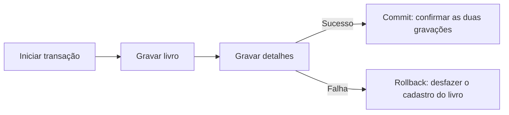

# Transações no Laravel

Na biblioteca, o cadastro de um livro e de seus detalhes envolve duas gravações. Imagine que o servidor grave o livro e encontre um erro ao gravar os detalhes. A pessoa recebe uma mensagem de erro, mas o livro já está no catálogo. Uma transação permite confirmar as duas gravações juntas ou desfazer a primeira se a segunda falhar.

## 1. O que é uma transação?

Uma **transação** agrupa operações que o banco trata como uma unidade. A propriedade de confirmar todas as alterações do grupo ou desfazer todas é chamada de **atomicidade**.

1. **Início** abre a transação.
2. **Commit** confirma as alterações quando as operações terminam com sucesso.
3. **Rollback** desfaz as alterações da transação quando a operação é interrompida por uma falha.



Em uma aplicação Web, um clique em **Cadastrar** pode fazer o servidor alterar várias tabelas. A transação ajuda a manter o banco em um estado coerente mesmo quando uma gravação falha no meio da operação.

## 2. Onde as transações são indispensáveis?

| Situação | O que deve ser gravado junto | O que a transação evita |
|---|---|---|
| Transferência entre contas no mesmo banco de dados | Debitar a conta de origem e creditar a conta de destino | O saldo diminuir de um lado sem aumentar do outro |
| Pedido em uma loja virtual | Gravar o pedido e seus itens e reservar as quantidades no estoque da loja | Um pedido incompleto ou uma reserva de estoque sem pedido |
| Matrícula em uma turma | Registrar a matrícula e atualizar a quantidade de vagas disponíveis | Uma vaga consumida sem matrícula ou uma matrícula sem a baixa da vaga |

As operações da transação continuam sujeitas às regras do sistema. Na matrícula, por exemplo, o sistema também precisa conferir a disponibilidade e proteger a última vaga contra duas solicitações simultâneas.

## 3. Como o Laravel executa uma transação?

Use `DB::transaction()` com uma função que reúne as gravações. Quando a função termina com sucesso, o Laravel faz o commit. Se uma exceção sair da função, o Laravel faz o rollback e repassa o erro. O método funciona com Eloquent e com o construtor de consultas na conexão usada pela transação. [Documentação do Laravel 13](https://laravel.com/framework/docs/13.x/database#database-transactions)

Valide os dados do formulário antes de abrir a transação. Dentro da função, deixe sair a exceção que deve cancelar o cadastro. Você pode tratar o erro do lado de fora, depois do rollback.

O Laravel também oferece `DB::beginTransaction()`, `DB::commit()` e `DB::rollBack()` para controlar cada etapa manualmente. [Controle manual na documentação](https://laravel.com/framework/docs/13.x/database#manually-using-transactions)

## 4. Cadastrar livro e detalhes juntos

O [formulário de cadastro](exemplos/resources/views/books/create.blade.php) da biblioteca recebe os campos do livro, a quantidade de páginas e um resumo opcional. O livro vai para `books`, e os detalhes vão para `book_details`.

Na ação `store()` do [BookController](exemplos/app/Http/Controllers/BookController.php), `$bookData` e `$detailData` contêm os dados já validados. O Controller importa `Illuminate\Support\Facades\DB` e faz as duas gravações no mesmo bloco.

```php
$book = DB::transaction(function () use ($bookData, $detailData): Book {
    $book = Book::create($bookData);
    $book->detail()->create($detailData);

    return $book;
});
```

O relacionamento `detail()` preenche `book_id` com o ID do livro recém-criado. Depois do commit, o Controller redireciona para a página do livro, que já exibe os detalhes.

A capa continua opcional. Quando ela é enviada, o arquivo é gravado no disco e seu caminho é salvo no banco. Se a transação falhar, o banco desfaz as gravações e o Controller apaga o arquivo recém-enviado no `catch`.

## 5. Praticar

Siga o [guia do exemplo](exemplos/README.md) para instalar a biblioteca e experimentar o cadastro.

1. Cadastre um livro com a quantidade de páginas e confira os detalhes na página do livro.
2. Simule uma exceção dentro da transação, logo após gravar o livro. Envie outro cadastro e confira que ele não aparece no catálogo.
3. Remova a exceção de teste e use o mesmo ISBN. O livro e seus detalhes devem ser gravados.
